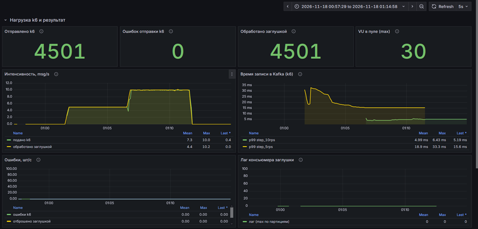
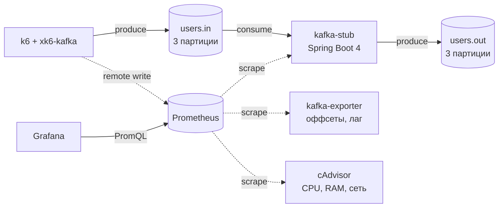
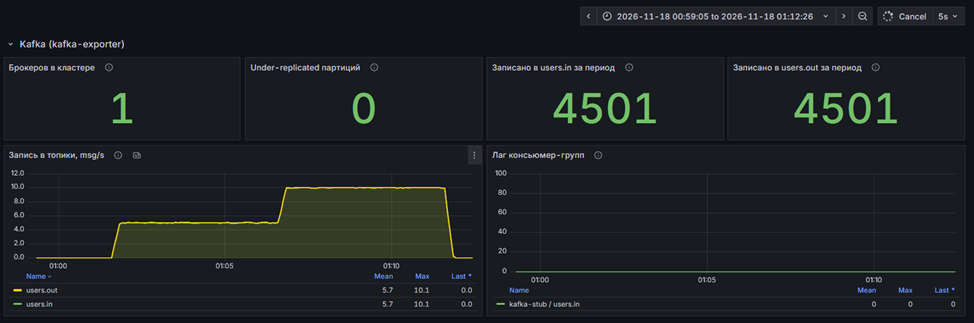

# Kafka Load Stand

**Стенд для нагрузочного тестирования сервиса на Kafka. Поднимается одной командой.**
Kafka 4 в режиме KRaft, сервис-заглушка на Spring Boot 4, генератор нагрузки k6 и мониторинг на Prometheus и Grafana. Весь стенд описан в одном `docker-compose.yml`.



## Зачем этот проект

Частая задача в микросервисах – проверить под нагрузкой интеграцию через Kafka, когда сервис-получатель ещё не готов или его нельзя нагружать. Тогда его место занимает заглушка с предсказуемым ответом, а нагрузку создаёт k6.

Стенд отвечает на вопросы:

- держит ли цепочка заданную интенсивность и где начинает копиться очередь (лаг);
- сколько времени занимают запись в брокер и обработка внутри сервиса (avg / p95 / p99);
- сколько CPU и памяти тратит каждый компонент;
- все ли сообщения дошли, а если нет, то на каком звене они потерялись.

## Что внутри

- **Java, Spring Boot, Kafka.** Сервис на Spring Boot 4 и Spring Kafka. Три консьюмера по числу партиций, асинхронная отправка с учётом подтверждения брокера. Ключ сообщения сохраняется в ответе, поэтому порядок по пользователю не нарушается. Невалидные сообщения не блокируют партицию. Есть собственные метрики Micrometer.
- **Docker и инфраструктура.** Семь сервисов в `docker compose`. Порядок старта задан через healthcheck, без `sleep`. Kafka 4 работает в KRaft, для хоста и для docker-сети у неё отдельные листенеры. Multi-stage Dockerfile кэширует зависимости. Лимиты памяти рассчитаны на ноутбук с 8 ГБ.
- **Мониторинг.** Метрики собираются с трёх уровней: приложение (Actuator), брокер (kafka-exporter), контейнеры (cAdvisor). k6 сам отправляет свои метрики в Prometheus через remote write. Источник данных и два дашборда Grafana лежат в репозитории и подключаются автоматически.
- **Нагрузочное тестирование.** Открытая модель нагрузки со ступенями 5 → 10 msg/s. Время записи замеряется без искажений (`acks=all`, без батчинга). Пропущенные итерации контролируются, а число сообщений сверяется по всей цепочке.

## Архитектура



k6 пишет в `users.in` сообщения вида `{"userId":"48213"}`, ключ сообщения равен userId. Заглушка дописывает к userId суффикс `123` и отправляет `{"userId":"48213123"}` в `users.out` с тем же ключом.

| Контейнер | Роль | Адрес с хоста |
|---|---|---|
| `kafka` | брокер и контроллер в одном процессе (KRaft) | `localhost:9092` |
| `kafka-init` | создаёт топики и завершается | — |
| `kafka-stub` | читает `users.in`, отвечает в `users.out` | http://localhost:8181 |
| `kafka-exporter` | оффсеты топиков, лаг консьюмер-групп | http://localhost:9308/metrics |
| `cadvisor` | CPU, память, сеть каждого контейнера | http://localhost:8088/docker/ |
| `prometheus` | хранит метрики, принимает remote write от k6 | http://localhost:9090 |
| `grafana` | дашборды | http://localhost:3000 (admin / admin) |

Внутри docker-сети `stand-net` Kafka доступна по адресу `kafka:29092`, с хоста — по `localhost:9092`.

## Результаты прогона

Профиль `load`: 5 msg/s 5 минут, затем 10 msg/s 5 минут. Ноутбук с AMD Ryzen 3 4300U и 8 ГБ RAM, весь стенд в Docker Desktop.

| Показатель | Результат |
|---|---|
| Сообщений: отправлено k6 → `users.in` → обработано заглушкой → `users.out` | 4501 → 4501 → 4501 → 4501 |
| Ошибки записи, отброшенные сообщения, `dropped_iterations` | 0 |
| Лаг консьюмер-группы | 0 на всём прогоне |
| Запись в Kafka из k6: медиана / p95 | 1,75 / 3,16 мс |
| Обработка сообщения в заглушке после прогрева | ≈ 0,2 мс |
| Отправка ответа заглушкой до подтверждения брокера | ≈ 6–7 мс |
| Heap заглушки / время в GC | до 35 MiB из 371 MiB / ≤ 0,1% CPU |
| Память Kafka | 447 MiB в среднем при лимите 1 GiB |

**Главное:**

- **Потерь и ошибок нет.** Число сообщений сходится по трём независимым источникам: счётчикам k6, метрикам заглушки и оффсетам брокера.
- **Это проверка стабильности, а не предела.** Одновременно был занят 1 VU из 30, CPU брокера между пиками — единицы процентов. Поиск предела — следующий шаг.
- **Все выбросы задержки — в первые секунды прогона:** загрузка классов, создание продюсера при первой отправке, один полный GC из-за роста Metaspace.
- **Отправка ответа заглушкой втрое дольше записи из k6.** Вероятная причина — `linger.ms = 5` по умолчанию в Java-клиенте Kafka 4 ([KIP-1030](https://cwiki.apache.org/confluence/display/KAFKA/KIP-1030%3A+Change+constraints+and+default+values+for+various+configurations)), гипотеза ждёт проверки.



Полный разбор всех графиков (Kafka, ресурсы контейнеров, JVM, GC) и план следующих проверок — в [docs/RESULTS.md](docs/RESULTS.md).

## Быстрый старт

**Нужно:** Docker Desktop или Docker Engine с Compose v2, около 8 ГБ RAM. Для нагрузки нужен k6 с расширением xk6-kafka (см. [Нагрузочный тест](#нагрузочный-тест)).

> [!NOTE]
> Стенд разрабатывался под Windows, поэтому часть команд приведена для PowerShell. Команды `docker` и `docker compose` одинаковы во всех ОС. Где синтаксис отличается, рядом дан вариант для bash.

```bash
git clone https://github.com/<username>/kafka-load-stand.git
cd kafka-load-stand
docker compose up -d --build
docker compose ps -a
```

Порядок старта:

1. Стартует `kafka`. Docker раз в 2 секунды проверяет её healthcheck'ом, пока брокер не ответит. Обычно это 15–30 секунд.
2. Когда `kafka` становится `healthy`, стартуют `kafka-init` и `kafka-exporter`. `kafka-init` создаёт топики и завершается со статусом `Exited (0)`, это ещё 5–10 секунд.
3. После этого стартует `kafka-stub`.
4. `cadvisor`, `prometheus` и `grafana` ни от кого не зависят и стартуют сразу.

> [!TIP]
> Пока идут шаги 1–3, `docker compose up` показывает `Waiting`, это нормально. Прерывать его Ctrl+C не нужно: прерванный `up` оставляет часть контейнеров несозданными. Если старт затянулся, логи можно посмотреть в соседнем окне: `docker compose logs -f kafka kafka-init`.

Ожидаемое состояние:

| Контейнер | Статус |
|---|---|
| `kafka` | `Up (healthy)` |
| `kafka-init` | `Exited (0)` |
| `kafka-stub`, `kafka-exporter`, `cadvisor`, `prometheus`, `grafana` | `Up` |

### Проверка одним сообщением

Окно 1, читаем выходной топик:

```bash
docker exec -it kafka /opt/kafka/bin/kafka-console-consumer.sh --bootstrap-server kafka:29092 --topic users.out --from-beginning
```

Окно 2, отправляем сообщение во входной:

```bash
echo '{"userId":"42"}' | docker exec -i kafka /opt/kafka/bin/kafka-console-producer.sh --bootstrap-server kafka:29092 --topic users.in
```

В окне 1 должно появиться `{"userId":"42123"}`. Если отправить мусор (`echo hello | ...`), заглушка напишет в лог WARN `Skip invalid JSON` и пропустит сообщение.

Лог заглушки: `docker compose logs -f stub`. При старте в нём должны быть `Tomcat started on port 8181` и `partitions assigned` с `users.in-0`, `users.in-1`, `users.in-2`.

<details>
<summary><b>Другие режимы запуска: заглушка из IDE, быстрая сборка образа, Offset Explorer</b></summary>

#### Заглушка из IntelliJ IDEA вместо контейнера

Нужен JDK 21 или новее.

```bash
docker compose up -d kafka-init kafka-exporter cadvisor prometheus grafana
```

`kafka` поднимется сама как зависимость `kafka-init`. Затем запустить `KafkaStubApplication` в IDEA: по умолчанию заглушка подключается к `localhost:9092`.

Нельзя запускать заглушку одновременно в IDEA и в контейнере: обе займут порт 8181, а в Kafka поделят партиции между собой.

#### Быстрая сборка образа из готового jar

По умолчанию образ собирается по `stub/Dockerfile`: Maven внутри контейнера качает зависимости и собирает jar. Первая сборка идёт несколько минут и требует интернета.

Быстрый вариант: собрать jar в IDEA (Maven → kafka-stub → Lifecycle → package, появится `stub/target/kafka-stub.jar`), затем собрать образ из него:

```powershell
# PowerShell, переменная живёт только в текущем окне
$env:STUB_DOCKERFILE = "Dockerfile.local"
docker compose up -d --build
```

```bash
# bash
STUB_DOCKERFILE=Dockerfile.local docker compose up -d --build
```

#### Offset Explorer

1. File → Add New Connection. Cluster name: `local`, Kafka Cluster Version — самая новая в списке, Zookeeper не заполнять.
2. Вкладка Advanced → Bootstrap servers: `localhost:9092` → Test → Add.
3. Topics → `users.in` → Properties → Content Types: Key = String, Value = String → Update.
4. Вкладка Data → зелёная кнопка ▶.

#### Интерактивный продюсер

Запустить `kafka-console-producer.sh` с `-it` и без `echo ... |`, затем вводить строки: одна строка — одно сообщение, выход по Ctrl+C. Знак `>` в начале строки — приглашение продюсера, вводить его не нужно. Иначе в топик уйдёт `>{"userId":"42"}`, и заглушка отбросит его как невалидный JSON.

</details>

### Остановка

```bash
docker compose down      # топики Kafka удаляются (у брокера нет volume), метрики и настройки Grafana остаются
docker compose down -v   # удалить и метрики с настройками
```

## Нагрузочный тест

### Профили

| Профиль | Нагрузка | Сообщений |
|---|---|---|
| `smoke` | 1 msg/s, 30 с | ≈ 30 |
| `load` (по умолчанию) | 5 msg/s 5 минут, затем 10 msg/s 5 минут | 4500 |

Параметры скрипта передаются через `-e ИМЯ=значение`:

| Переменная | По умолчанию | Смысл |
|---|---|---|
| `BROKERS` | `localhost:9092` | адреса брокеров через запятую |
| `TOPIC` | `users.in` | топик для нагрузки |
| `PROFILE` | `load` | `smoke` или `load` |

### Установка k6 с xk6-kafka

В k6 нет поддержки Kafka из коробки, нужно расширение [xk6-kafka](https://github.com/mostafa/xk6-kafka). Обычный k6 из winget не подходит: автоматическая подтяжка расширения падает с ошибкой `unknown dependency : k6/x/kafka`.

**Вариант А: готовая сборка.** В [релизах xk6-kafka](https://github.com/mostafa/xk6-kafka/releases) взять архив под свою ОС. Для Windows:

```powershell
tar -xzf .\xk6-kafka_v2.2.0_windows_amd64.exe.tar.gz
Get-ChildItem -Recurse -Filter "xk6-kafka*.exe" | Select-Object FullName
Move-Item "<путь из вывода выше>" .\k6kafka.exe
.\k6kafka.exe version
```

Если Windows SmartScreen спросит про запуск: «Подробнее» → «Выполнить в любом случае».

**Вариант Б: k6 в Docker.** Ничего не нужно устанавливать, контейнер подключается к сети стенда:

```powershell
docker run --rm -it --network stand-net -v "${PWD}\k6:/scripts" mostafamoradian/xk6-kafka:latest run -e BROKERS=kafka:29092 -e PROFILE=smoke /scripts/load.js
```

В bash вместо `"${PWD}\k6"` указать `"$(pwd)/k6"`. Чтобы метрики попали в Prometheus, добавить `-e K6_PROMETHEUS_RW_SERVER_URL=http://prometheus:9090/api/v1/write` перед именем образа и `-o experimental-prometheus-rw` после `run`: внутри сети стенда Prometheus доступен по имени сервиса.

### Запуск

Переменные окружения задаются в том же окне терминала, где запускается k6:

```powershell
# PowerShell
$env:K6_PROMETHEUS_RW_SERVER_URL   = "http://localhost:9090/api/v1/write"
$env:K6_PROMETHEUS_RW_TREND_STATS  = "avg,p(95),p(99),max"
$env:K6_PROMETHEUS_RW_STALE_MARKERS = "true"
$env:K6_WEB_DASHBOARD              = "true"
$env:K6_WEB_DASHBOARD_EXPORT       = "k6-report.html"
```

```bash
# bash
export K6_PROMETHEUS_RW_SERVER_URL=http://localhost:9090/api/v1/write
export K6_PROMETHEUS_RW_TREND_STATS="avg,p(95),p(99),max"
export K6_PROMETHEUS_RW_STALE_MARKERS=true
export K6_WEB_DASHBOARD=true
export K6_WEB_DASHBOARD_EXPORT=k6-report.html
```

- `K6_PROMETHEUS_RW_*` — куда и какие статистики k6 отправляет в Prometheus. `STALE_MARKERS` обрывает линии на графиках сразу после теста, иначе они тянутся ещё 5 минут.
- `K6_WEB_DASHBOARD` — встроенный дашборд k6 на http://localhost:5665 во время теста. `EXPORT` сохраняет его в HTML-отчёт по окончании.

```powershell
.\k6kafka.exe run -o experimental-prometheus-rw -e PROFILE=smoke k6/load.js   # смоук, 30 с
.\k6kafka.exe run -o experimental-prometheus-rw k6/load.js                    # основной, 10 минут
```

В Linux и macOS то же самое, только бинарник вызывается как `./k6kafka`. Без `-o experimental-prometheus-rw` метрики k6 не попадут в Prometheus, и панели k6 в Grafana останутся пустыми.

**Что смотреть в сводке k6:**

- `iterations` ≈ 4500 (5 × 300 + 10 × 300), для смоука ≈ 30;
- `dropped_iterations` отсутствует или равен 0. Если нет, k6 не хватило VU, чтобы держать заданную интенсивность;
- `kafka_writer_error_count` = 0;
- `kafka_writer_write_seconds` — время записи в брокер (avg, p95).

<details>
<summary><b>PowerShell «завис» в конце теста</b></summary>

Если в заголовке окна написано «Выделить» / «Select», значит, был клик мышью в консоль: классическая консоль Windows ставит программу на паузу, пока выделен текст. Нажать Esc. Чтобы это не повторялось: ПКМ по заголовку → Свойства → снять «Выделение мышью» (QuickEdit). Другой вариант — запускать k6 в Windows Terminal или в терминале IntelliJ.

</details>

## Мониторинг

**Prometheus** (http://localhost:9090) → Status → Target health. В статусе `UP` должны быть `kafka-stub`, `kafka-exporter`, `cadvisor` и `prometheus`. k6 в этом списке нет: Prometheus его не опрашивает, k6 сам присылает метрики.

**Grafana** (http://localhost:3000, admin / admin) → Dashboards → папка «Стенд»:

- **«Нагрузка k6 и заглушка»** — сколько отправлено k6 и обработано заглушкой, интенсивность msg/s, время записи (avg/p95/p99), ошибки, лаг консьюмера, время обработки и отправки внутри заглушки.
- **«Kafka и контейнеры»** — брокеры, under-replicated партиции, сколько записано в топики за период, скорость записи по оффсетам, лаг консьюмер-групп, а также CPU, память и сеть каждого контейнера.
- **JVM заглушки** — готовый дашборд из каталога Grafana: Dashboards → New → Import → ID `4701` → Load → источник Prometheus → Import. Вверху выбрать application = `kafka-stub`. Для импорта нужен интернет. Дашборд хранится в volume `grafana-data` и переживает `docker compose down`, но не `down -v`.

**Метрики заглушки** (http://localhost:8181/actuator/prometheus):

| Метрика | Что показывает |
|---|---|
| `stub_messages_total{result=...}` | свой счётчик: `sent` / `rejected` / `send_error` |
| `spring_kafka_listener_seconds` | время обработки одного сообщения слушателем |
| `spring_kafka_template_seconds` | время отправки ответа до подтверждения брокером |
| `kafka_consumer_fetch_manager_records_lag_max` | лаг по метрикам Kafka-клиента |
| `jvm_memory_used_bytes` и другие `jvm_*` | состояние JVM |

> [!NOTE]
> Дашборды «Стенд» Grafana загружает из файлов при старте. Правки из интерфейса сохраняются, но если изменить JSON-файл, при следующем старте он перезапишет эти правки. Чтобы перенести правку из интерфейса в репозиторий: Dashboard → Export → Export as JSON → заменить файл.

## Сверка: все ли сообщения дошли

Цепочка состоит из трёх звеньев. Первое звено, где цифры не сходятся, и есть место поломки.

| Звено | Как проверить |
|---|---|
| k6 → `users.in` | в сводке k6 `kafka_writer_message_count` и `kafka_writer_error_count`; оффсеты `users.in` растут |
| `users.in` → заглушка | состояние консьюмер-группы (команда ниже); в логе заглушки нет WARN `Skip invalid JSON` |
| заглушка → `users.out` | `stub_messages_total{result="sent"}` растёт; оффсеты `users.out` растут |

Состояние консьюмер-группы:

```bash
docker exec kafka /opt/kafka/bin/kafka-consumer-groups.sh --bootstrap-server kafka:29092 --describe --group kafka-stub
```

По строке на каждую партицию:

- `CURRENT-OFFSET` — докуда группа дочитала и закоммитила;
- `LOG-END-OFFSET` — сколько всего сообщений в партиции;
- `LAG` — разница, то есть сколько сообщений ещё не обработано;
- `CONSUMER-ID` — какой консьюмер заглушки держит партицию. Если пусто, заглушка не подключена.

Сумма оффсетов по всем партициям топика (выполнить до и после прогона, разница — число сообщений за прогон):

```powershell
# PowerShell
docker exec kafka /opt/kafka/bin/kafka-get-offsets.sh --bootstrap-server kafka:29092 --topic users.out |
  ForEach-Object { [int]($_ -split ':')[2] } | Measure-Object -Sum | Select-Object -ExpandProperty Sum
```

```bash
# bash
docker exec kafka /opt/kafka/bin/kafka-get-offsets.sh --bootstrap-server kafka:29092 --topic users.out | awk -F: '{s+=$3} END {print s}'
```

Ещё два способа посчитать: панели «Записано в users.in за период» и «Записано в users.out за период» на дашборде «Kafka и контейнеры» (выставить период так, чтобы в него попал ровно один прогон). Или поднять стенд с нуля (`down`, затем `up -d --build`) и сразу запустить основной прогон: тогда оффсеты в обоих топиках будут ≈ 4500.

## Инженерные решения

### Kafka и docker compose

- **KRaft без ZooKeeper.** Используется официальный образ `apache/kafka:4.3.2`. Один процесс совмещает роли брокера и контроллера (`KAFKA_PROCESS_ROLES: broker,controller`), кворум контроллеров состоит из одного узла. Kafka 4 работает только в KRaft, а для локального стенда это ещё и минус один контейнер.
- **Два клиентских листенера.** Клиент подключается по bootstrap-адресу, получает в метаданных advertised-адреса брокеров и дальше ходит только по ним. Контейнерам нужен `kafka:29092` (INTERNAL), хосту — `localhost:9092` (EXTERNAL), поэтому листенеров два. Третий листенер, CONTROLLER на 9093, служебный: он нужен для кворума. Наружу проброшен только EXTERNAL.
- **Порядок старта без `sleep`.** Healthcheck брокера вызывает `kafka-broker-api-versions.sh`: если брокер ответил на запрос версий API, значит, он принимает запросы. Пока идёт `start_period`, проверка выполняется каждые 2 секунды (`start_interval`), потом раз в минуту. `kafka-init` ждёт `service_healthy` от брокера. Заглушка ждёт `service_completed_successfully` от `kafka-init`, то есть стартует, когда топики уже созданы.
- **Healthcheck не съедает память брокера.** CLI-утилиты Kafka унаследовали бы `KAFKA_HEAP_OPTS` брокера (256–512 МБ) и упёрлись бы в `mem_limit` контейнера. Поэтому перед командой стоит `KAFKA_HEAP_OPTS=-Xmx64m`.
- **Топики создаются явно и идемпотентно.** `KAFKA_AUTO_CREATE_TOPICS_ENABLE: false`, так что опечатка в имени топика даёт ошибку, а не новый пустой топик, куда молча уходит нагрузка. `kafka-init` создаёт топики с `--if-not-exists`, поэтому повторный запуск безопасен, а `set -e` завершает контейнер с ошибкой, если создать топик не удалось. Вызовов `kafka-topics.sh` минимум, потому что каждый из них запускает отдельную JVM.
- **Настройки под один брокер.** Фактор репликации служебных топиков и `min.insync.replicas` равны 1, иначе на одном брокере эти топики не создадутся. `GROUP_INITIAL_REBALANCE_DELAY_MS: 0` убирает трёхсекундную паузу перед сборкой консьюмер-группы.
- **Память под ноутбук на 8 ГБ.** Heap брокера ограничен 512 МБ при `mem_limit: 1g`. Заглушка запускается с `-XX:MaxRAMPercentage=75`, поэтому heap считается от лимита контейнера, а не от памяти хоста.
- **Multi-stage Dockerfile.** Первый этап копирует только `pom.xml` и скачивает зависимости. Этот слой кэшируется, пока `pom.xml` не меняется, поэтому после правки кода пересборка идёт быстро. Во втором этапе остаются только чистый JRE и jar. Для демо есть `Dockerfile.local`, который собирает образ из jar, собранного в IDE. Нужный Dockerfile выбирается через `${STUB_DOCKERFILE:-Dockerfile}`, а `Dockerfile.local.dockerignore` не передаёт исходники в контекст сборки.
- **Фиксированное имя сети `stand-net`.** К стенду можно подключать разовые контейнеры, например k6: `docker run --network stand-net ...`.

### Сервис-заглушка

- **Конкурентность по числу партиций.** `listener.concurrency: 3` создаёт три консьюмера в одной группе, по одному на каждую партицию `users.in`. Потоков больше, чем партиций, делать нет смысла: лишние простаивали бы.
- **Ключ переносится в ответ.** Ключ равен userId, поэтому все сообщения одного пользователя проходят через одну партицию и обрабатываются по порядку. Есть нюанс: k6 (xk6-kafka v2) пишет через клиент Confluent, а заглушка — через Java-клиент, и ключ они хешируют по-разному. Поэтому номер партиции ответа в `users.out` может не совпадать с номером партиции запроса, но для одного ключа он всегда один и тот же.
- **Невалидные сообщения не блокируют партицию.** Пустое сообщение, битый JSON или пустой userId дают WARN в лог и `+1` к счётчику `rejected`, а сообщение пропускается без ретраев. Так одно «ядовитое» сообщение не останавливает чтение всей партиции. Благодаря `@JsonIgnoreProperties(ignoreUnknown = true)` лишние поля во входном JSON не ломают разбор.
- **Отправка учитывается по факту подтверждения.** `KafkaTemplate.send` асинхронный, поэтому счётчики `sent` и `send_error` увеличиваются в `whenComplete`, то есть после ответа брокера, а не в момент вызова.
- **Свои метрики.** Счётчик Micrometer `stub.messages` с тегом `result` в Prometheus называется `stub_messages_total`. Общий тег `application="kafka-stub"` на всех метриках нужен JVM-дашборду для фильтрации.
- **Конфигурация снаружи.** Адрес брокера берётся из `KAFKA_BOOTSTRAP_SERVERS`, а по умолчанию равен `localhost:9092`, поэтому один и тот же код работает и в контейнере, и из IDE. Топики и суффикс вынесены в `application.yml`. `auto-offset-reset: earliest` нужен, чтобы новая группа читала партицию с начала.

### Нагрузка

- **Открытая модель нагрузки.** Сценарии `constant-arrival-rate` заставляют k6 запускать ровно `rate` итераций в секунду, сколько бы ни длилась каждая. В закрытой модели с фиксированным числом VU тормозящая система сама снижала бы нагрузку, и деградация осталась бы незамеченной. Если свободных VU не хватает, итерация не выполняется и попадает в `dropped_iterations`.
- **Время записи без искажений.** `requiredAcks: -1` (acks=all) заставляет k6 ждать подтверждения от брокера, иначе он мерил бы время укладки сообщения в буфер клиента. `batchSize: 1` отправляет каждое сообщение сразу: по умолчанию клиент копит пачку до 1 секунды, и это ожидание попало бы в метрику.
- **Своё подключение у каждого VU.** `Writer` создаётся в init-контексте, который выполняется один раз на каждый VU.
- **Нагрузка распределена по партициям.** userId выбирается случайно от 1 до 1 000 000 и используется как ключ.

### Мониторинг

- **Pull и push.** Prometheus сам раз в 5 секунд опрашивает заглушку, kafka-exporter и cAdvisor. k6 — короткоживущий процесс, его неудобно опрашивать, поэтому он отправляет метрики сам через remote write (`--web.enable-remote-write-receiver`).
- **Одна конфигурация для двух режимов.** Prometheus обращается к заглушке через `host.docker.internal:8181`. Это работает и для заглушки в контейнере (через проброшенный порт), и для заглушки, запущенной в IDE.
- **Grafana as code.** Источник данных с фиксированным `uid: prometheus` и дашборды лежат в `grafana/provisioning` и подхватываются при старте. `timeInterval: 5s` совпадает со `scrape_interval`, от него Grafana считает `$__rate_interval`.
- **cAdvisor** запускается с `--docker_only`, чтобы в метриках были только контейнеры. `--housekeeping_interval=5s` совпадает с интервалом опроса Prometheus.

## Структура проекта

```
kafka-load-stand/
├── docker-compose.yml               # весь стенд: 7 сервисов
├── .gitignore
├── docs/
│   ├── RESULTS.md                   # разбор прогона по графикам
│   └── img/                         # скриншоты Grafana
├── k6/load.js                       # профили и сценарии нагрузки
├── prometheus/prometheus.yml        # цели опроса
├── grafana/provisioning/
│   ├── datasources/prometheus.yml   # источник данных
│   └── dashboards/
│       ├── dashboards.yml           # загрузка дашбордов из файлов
│       ├── k6-kafka-load.json       # «Нагрузка k6 и заглушка»
│       └── kafka-containers.json    # «Kafka и контейнеры»
└── stub/                            # сервис-заглушка
    ├── Dockerfile                   # multi-stage: Maven → JRE
    ├── Dockerfile.local             # образ из готового jar
    ├── Dockerfile.local.dockerignore
    ├── pom.xml
    └── src/main/
        ├── java/perf/stub/
        │   ├── KafkaStubApplication.java
        │   ├── UserIdListener.java  # чтение, обработка, отправка ответа
        │   ├── UserMessage.java     # record для JSON
        │   └── MetricsConfig.java   # общий тег application
        └── resources/application.yml
```

**Стек:** Java 21, Spring Boot 4.1 (Spring Kafka, Actuator, Micrometer, Jackson 3), Apache Kafka 4.3, k6 + xk6-kafka, Prometheus, Grafana, kafka-exporter, cAdvisor, Docker Compose.

## Если что-то пошло не так

<details>
<summary><b>Частые проблемы и решения</b></summary>

| Симптом | Причина и что делать |
|---|---|
| `docker compose up` долго висит на `Waiting` | Ждёт healthcheck Kafka и завершения `kafka-init`. Смотреть `docker compose logs -f kafka kafka-init`, не прерывать |
| `kafka` в статусе `unhealthy` | `docker compose logs kafka`. Чаще всего не хватает памяти: закрыть лишние программы, сделать `docker compose down` и `up` заново |
| `kafka-init` в статусе `Exited (1)` | `docker compose logs kafka-init`, затем повторить `docker compose up -d` |
| Offset Explorer подключился, но топики не открываются | В Bootstrap servers указан не `localhost:9092`. С хоста можно подключиться только через EXTERNAL-листенер |
| В логе заглушки `Connection to node -1 ... could not be established` | Kafka не запущена |
| `Port 8181 was already in use` | Заглушка уже запущена: в контейнере или второй копией в IDE |
| `docker compose up` ругается на порт 9092 | Порт занят другим процессом. Windows: `netstat -ano \| findstr :9092`, Linux/macOS: `lsof -i :9092` |
| k6: `dropped_iterations` > 0 | Не хватило VU. Увеличить `preAllocatedVUs` и `maxVUs` в `k6/load.js` |
| Target `kafka-exporter` в Prometheus `DOWN` | `docker compose logs kafka-exporter`. Экспортер стартует после healthcheck Kafka и сам перезапускается |
| На http://localhost:8088/docker/ нет контейнеров, панели cAdvisor пустые | См. ниже |

**cAdvisor не видит контейнеры.** Проверить `docker logs cadvisor`. Ошибка `failed to identify the read-write layer ID` означает, что cAdvisor не понимает хранилище образов containerd, которое в Docker Desktop включено по умолчанию. Выключить его: Docker Desktop → Settings → General → снять «Use containerd for pulling and storing images» → Apply. Образы из другого хранилища станут невидимыми, поэтому затем выполнить `docker compose up -d --build`, и образы скачаются заново. Запасной вариант для демо — `docker stats`.

**Метрики k6 пропали после сна ноутбука.** После сна часы виртуальной машины Docker отстают от Windows, и метрики k6 «пропадают» из Prometheus. Сравнить `Get-Date` и `docker exec prometheus date` (в контейнере время в UTC). Лечится так:

```powershell
docker compose down
wsl --shutdown
```

Затем запустить Docker Desktop и снова выполнить `docker compose up -d --build`.

**Память.** На 8 ГБ стенд работает, но перед 10-минутным прогоном лучше закрыть браузер с кучей вкладок. После работы `wsl --shutdown` вернёт системе память, которую держит Docker.

</details>

## Ограничения и что можно развить

- **Прогон проверил стабильность, а не предел.** Следующий сценарий — `ramping-arrival-rate` со ступенями до сотен msg/s, пока не появятся `dropped_iterations`, лаг или рост p95. Остальные проверки по итогам прогона перечислены в [docs/RESULTS.md](docs/RESULTS.md#что-проверить-дальше).
- **Один брокер и фактор репликации 1** — сознательный выбор под ноутбук. Поведение при отказе брокера и работу `min.insync.replicas` этот стенд не проверяет. Следующий шаг — кластер из трёх брокеров и сценарий с остановкой одного из них под нагрузкой.
- **Сквозная задержка k6 → `users.out` не измеряется.** Сейчас отдельно видны запись в брокер и обработка в заглушке. Можно передавать время отправки в заголовке сообщения и строить end-to-end гистограмму.
- **Невалидные сообщения просто пропускаются.** В боевом сервисе их стоило бы отправлять в dead letter topic.
- **Нет автотестов.** Напрашиваются тесты заглушки на Testcontainers и смоук-прогон стенда в GitHub Actions.
