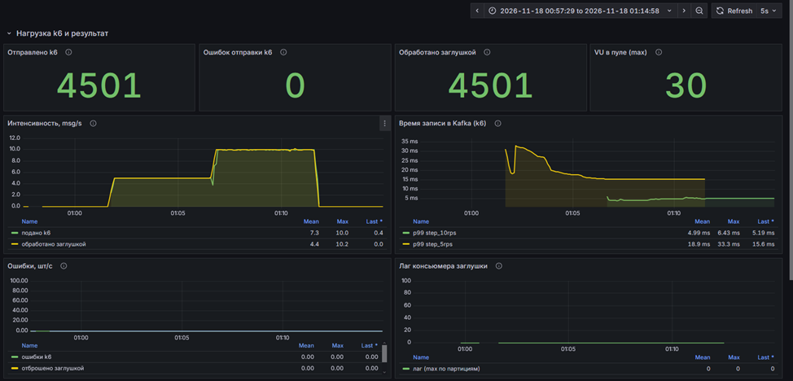
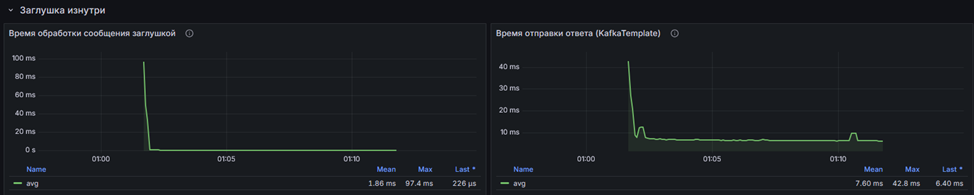
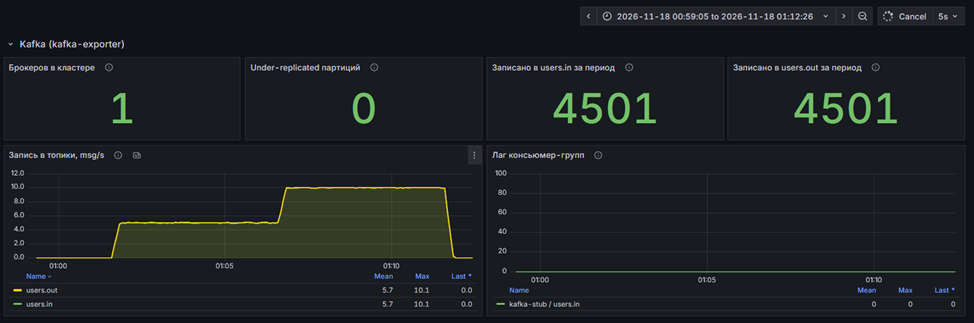
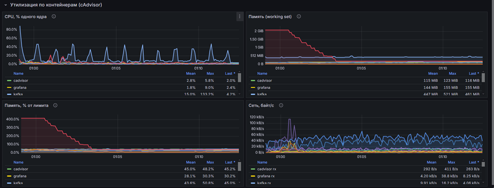
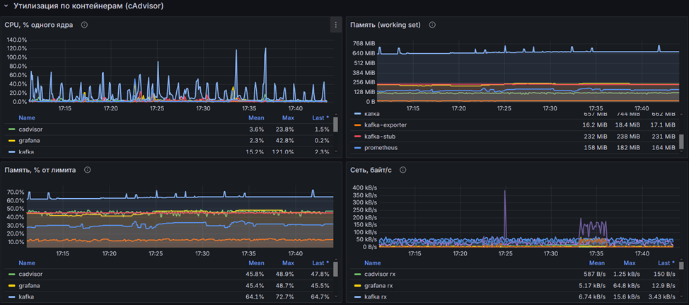
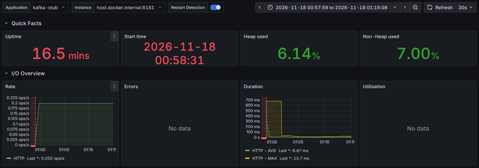
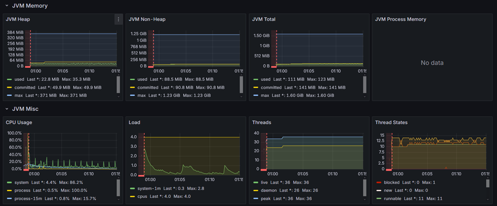
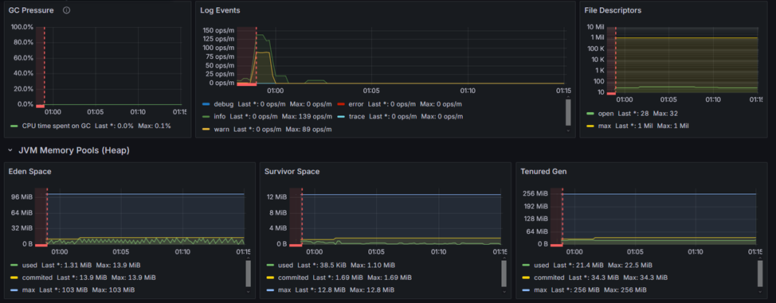
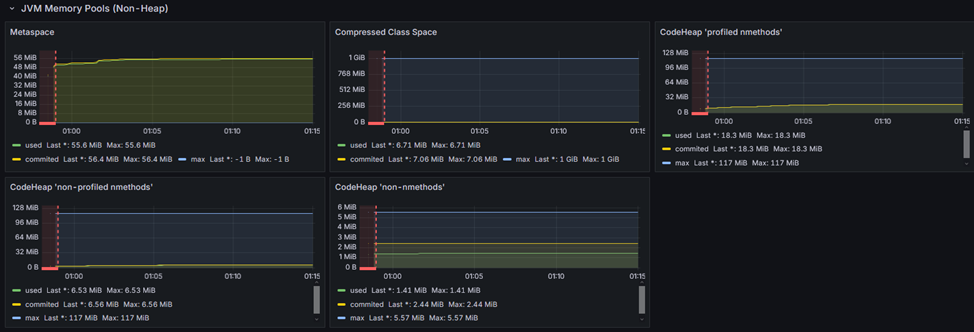
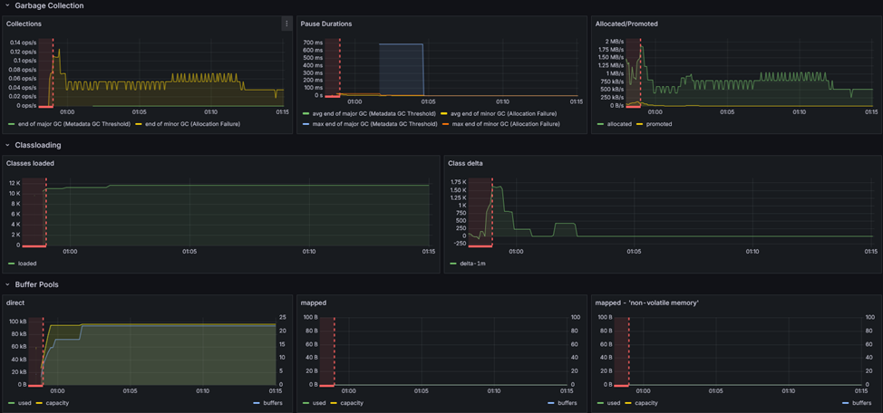

# Результаты нагрузочного теста

[← назад к README](../README.md)

Полный разбор основного прогона по графикам Grafana и сводке k6: что показывает каждый график и какие выводы из него следуют. Короткая версия — в разделе [«Результаты прогона»](../README.md#результаты-прогона) в README.

## Условия

| | |
|---|---|
| Дата | 18 ноября 2026, нагрузка ≈ 01:01:40–01:11:40 |
| Профиль | `load`: 5 msg/s 5 минут (сценарий `step_5rps`), затем 10 msg/s 5 минут (`step_10rps`) |
| Машина | ноутбук: AMD Ryzen 3 4300U (4 ядра, 2,7 ГГц), 8 ГБ RAM, SSD |
| Окружение | Windows 64-bit, Docker Desktop (WSL 2). Стенд и k6 работают на одной машине |
| Заглушка | в контейнере; максимум heap 371 MiB (`-XX:MaxRAMPercentage=75` от лимита памяти контейнера) |

## Итоги

| Показатель | Результат |
|---|---|
| Отправлено k6 | 4501 |
| Записано в `users.in` (по оффсетам брокера) | 4501 |
| Обработано заглушкой | 4501 |
| Записано в `users.out` (по оффсетам брокера) | 4501 |
| Ошибки записи k6 / ретраи | 0 / 0 |
| Отброшено заглушкой (невалидные, ошибки отправки) | 0 |
| `dropped_iterations` | 0 (метрика не появилась в сводке) |
| Лаг консьюмер-группы `kafka-stub` | 0 на всём прогоне |
| Запись в Kafka из k6: avg / медиана / p90 / p95 / max | 2,2 / 1,75 / 2,5 / 3,16 / 426,55 мс |
| Обработка сообщения в заглушке, avg | 1,86 мс за прогон, ≈ 0,2 мс после прогрева |
| Отправка ответа до подтверждения брокера, avg | 7,6 мс за прогон, ≈ 6–7 мс после прогрева |
| VU: выделено / занято одновременно | 30 / максимум 1 |
| Heap заглушки: занято / максимум | до 35 MiB / 371 MiB |
| Время JVM заглушки в GC | ≤ 0,1% CPU |
| Память Kafka: среднее / максимум | 447 / 521 MiB при лимите 1 GiB |

Расчётное число сообщений — 4500, k6 выполнил 4501 итерацию. Главное, что число одинаковое на всех четырёх звеньях, и его подтверждают три независимых источника: счётчики k6, метрики заглушки и оффсеты брокера.

---

## 1. Нагрузка и время записи

- **Интенсивность.** Две ступени, 5 и 10 msg/s. Линии «подано k6» и «обработано заглушкой» совпадают, значит, заглушка успевает за нагрузкой без отставания. Средние в легенде различаются (7,3 и 4,4), потому что серия заглушки существует и вне прогона со значением 0, а серия k6 — только во время теста. Максимумы совпадают: 10,0 и 10,2.
- **Ошибки и лаг.** Ошибок нет ни у k6, ни у заглушки. Лаг консьюмера на всём прогоне 0. Prometheus опрашивает метрики раз в 5 секунд, так что если очередь и возникала, она рассасывалась быстрее.
- **Время записи, p99 по ступеням.** На 5 msg/s p99 держится около 16–33 мс, а на 10 msg/s — около 5 мс. Это не значит, что под большей нагрузкой система работает быстрее. Причин две:
  1. k6 считает перцентили для Prometheus накопительно, по всем замерам с начала теста, а не за последние секунды. Это видно по графику: линия `step_5rps` продолжается ровно и после окончания своей ступени.
  2. В первую ступень попал прогрев. p99 первой ступени стартует примерно с 32 мс и плавно снижается по мере того, как ранние медленные замеры разбавляются новыми быстрыми. Вторая ступень стартовала на прогретой системе.

  По всему прогону запись из k6 занимает в медиане 1,75 мс, p95 — 3,16 мс.
- **Настройки продюсера k6 сработали как задумано.** `kafka_writer_batch_max = 1`, `kafka_writer_async = 0%`, время ожидания в очереди клиента (`kafka_writer_batch_queue_seconds`) — 0. Значит, `kafka_writer_write_seconds` — это чистое время записи с подтверждением брокера.
- **VU.** Выделено 30 (10 и 20 на две ступени), но одновременно был занят максимум 1 (`vus max=1` в сводке). Итерация длится около 2 мс, поэтому при 10 msg/s один VU занят примерно 2% времени. Запас по VU огромный.

## 2. Заглушка изнутри

- **Обработка сообщения слушателем.** Первые сообщения обрабатывались до 97 мс, затем около 0,2 мс (последнее значение — 226 мкс). Медленный старт объясняется прогревом. На первых сообщениях JVM догружает классы: это видно по всплеску Class delta и росту Metaspace в [разделе 5](#5-jvm-заглушки). Кроме того, Spring Kafka создаёт продюсер только при первой отправке, а клиент в этот момент запрашивает метаданные топика.
- **Отправка ответа (`KafkaTemplate`) до подтверждения брокера.** В начале — до 43 мс, дальше стабильно 6–7 мс. Это втрое дольше записи из k6 (около 2 мс), хотя брокер тот же. **Вероятная причина — `linger.ms`.** Начиная с Kafka 4.0 Java-продюсер по умолчанию ждёт до 5 мс, собирая пачку ([KIP-1030](https://cwiki.apache.org/confluence/display/KAFKA/KIP-1030%3A+Change+constraints+and+default+values+for+various+configurations)), а k6 отправляет каждое сообщение сразу (`batchSize: 1`). Около 2 мс записи и до 5 мс ожидания как раз дают наблюдаемые 6–7 мс. Проверить гипотезу можно повторным прогоном с `spring.kafka.producer.properties.linger.ms=0`.

## 3. Kafka

- Один брокер, under-replicated партиций нет.
- За период прогона записано 4501 сообщение в `users.in` и 4501 в `users.out`. Это сверка по оффсетам самого брокера, она не зависит от метрик k6 и заглушки.
- Скорость записи в оба топика совпадает по форме и по значениям (максимум 10,1 msg/s): ответ появляется в `users.out` в том же темпе, в каком приходят запросы.
- Лаг группы `kafka-stub` по данным kafka-exporter — 0.

## 4. Ресурсы контейнеров

### Во время прогона

- **CPU Kafka.** В среднем 15% одного ядра, но в основном это регулярные пики до 35–50% примерно раз в минуту. Между пиками брокер тратит около 5–8%. Максимум 133% приходится на старт брокера, ещё до нагрузки. Пики не зависят от ступени нагрузки и по периоду совпадают с healthcheck'ом брокера: раз в минуту он запускает в контейнере отдельную JVM с `kafka-broker-api-versions.sh`. Похоже, что на таком профиле заметную часть CPU брокера тратит его собственная проверка здоровья, а не сообщения. Проверить это можно, увеличив `interval` healthcheck'а и сравнив график.
- **Память Kafka.** В среднем 447 MiB, максимум 521 MiB: примерно половина лимита 1 GiB (43,6% и 50,8%).
- **Остальные контейнеры.** cAdvisor занимает около 115 MiB, Grafana — около 144 MiB. Сетевой трафик — единицы и десятки килобайт в секунду.
- **Красная линия** в начале графиков памяти (до 2 GiB) есть с самого начала отрезка, ещё до нагрузки, и к ~01:03 сходит на нет(kafka-stub).

### Получасовой отрезок

Те же панели на получасовом отрезке другой сессии (17:13–17:43). Здесь видны контейнеры, которые на предыдущем скриншоте скрыты прокруткой легенды:

| Контейнер | Память, среднее / максимум |
|---|---|
| `kafka` | 657 / 744 MiB (64% / 73% лимита) |
| `kafka-stub` | 232 / 238 MiB |
| `prometheus` | 158 / 182 MiB |
| `kafka-exporter` | 16 / 18 MiB |

- **Kafka — самый «тесный» контейнер стенда.** В этой сессии брокер занимал до 73% лимита. При более длинных или интенсивных прогонах за его лимитом нужно следить в первую очередь.
- **Контейнер заглушки занимает около 232 MiB, а JVM по своим метрикам — около 120 MiB** (heap + non-heap, [раздел 5](#5-jvm-заглушки)). Разница — нативная память JVM: стеки потоков, служебные структуры GC и JIT, загруженные библиотеки. Micrometer её не показывает, поэтому панель JVM Process Memory пустая. Цифры взяты из разных сессий, но порядок величин сопоставим.

## 5. JVM заглушки

Дашборд [JVM (Micrometer), ID 4701](https://grafana.com/grafana/dashboards/4701), фильтр `application = kafka-stub`. Красная пунктирная линия около 00:58:30 — старт приложения.

### Общее состояние

- Приложение работает 16,5 минут, стартовало в 00:58:31. Heap занят на 6,14%, non-heap — на 7%.
- **HTTP-панели показывают не нагрузку.** У заглушки нет HTTP API, и весь HTTP-трафик — это опрос `/actuator/prometheus` Prometheus'ом: 0,2 запроса в секунду, то есть раз в 5 секунд. Endpoint отвечает в среднем за ~7 мс. Первый запрос после старта занял около 700 мс. Панель Errors пустая, HTTP-ошибок не было.

### Память, CPU, потоки

- **Heap** занят максимум на 35 MiB из 371 MiB. Максимум heap задан `-XX:MaxRAMPercentage=75` от лимита памяти контейнера.
- **Non-heap** — 88,5 MiB, это в основном Metaspace и кеш JIT-кода (см. ниже). Всего JVM использует 111–123 MiB.
- **CPU процесса** после старта меньше 1%. Micrometer считает его от всех 4 ядер, пик до 100% пришёлся на запуск приложения.
- **Потоки.** В момент начала нагрузки (~01:01:40) число потоков выросло с 33 до 36, все три новых — daemon. Среди них сетевой поток продюсера, который Spring Kafka создаёт при первой отправке. Дальше число потоков не меняется.

### Логи, пулы heap и какой работает GC

- **GC Pressure** ≤ 0,1%: на сборку мусора уходит пренебрежимо мало CPU.
- **Логи.** INFO и WARN есть только при старте приложения, до нагрузки. Во время прогона — ноль, ERROR — ноль за весь период. Отсутствие WARN подтверждает, что невалидных сообщений не было: о каждом из них заглушка пишет WARN.
- **Пулы heap.** Eden заполняется и очищается «пилой» — это обычные сборки молодого поколения. Survivor почти пуст. Tenured Gen держится около 21 MiB и не растёт, то есть долгоживущие объекты не копятся и признаков утечки памяти нет.
- **Работает Serial GC.** Это видно по именам пулов (`Eden Space`, `Survivor Space`, `Tenured Gen`) и причинам сборок (`Allocation Failure`). JVM выбирает его сама, когда ей доступно меньше 2 CPU или меньше ~2 ГБ памяти. CPU здесь 4 (панель Load), значит, причина — лимит памяти контейнера. Для сервиса такого размера это нормальный выбор, но неявный. Если важна предсказуемость пауз, сборщик лучше задать явно (например, `-XX:+UseG1GC`) и сравнить результаты.

### Non-heap

- **Metaspace** — 55,6 MiB. В начале нагрузки он вырос примерно с 50 до 55 MiB: классы, которые нужны только для обработки сообщений, загружаются при первых сообщениях.
- **Кеш JIT-кода** (три пула CodeHeap) — около 26 MiB, Compressed Class Space — 6,7 MiB.

### Сборка мусора и загрузка классов

- **Частота minor GC растёт вместе с нагрузкой.** После прогона — около 0,035 сборки в секунду (раз в ~30 с), на 10 msg/s — около 0,065 (раз в ~15 с). Объём выделенной памяти — 0,5–1 MB/s, в старое поколение почти ничего не переходит (promoted ≈ 0): объекты умирают молодыми, как и должно быть у обработчика сообщений.
- **Самая длинная пауза — один полный GC ≈ 0,7 с в начале нагрузки** с причиной `Metadata GC Threshold`. На первых сообщениях JVM догружала классы, Metaspace перешёл порог и вызвал полную сборку. В метриках задержки пауза не проявилась, но при большей интенсивности дала бы заметный всплеск лага. Её можно убрать из замера двумя способами: прогревом перед основной ступенью или более высоким начальным порогом Metaspace (`-XX:MetaspaceSize=128m`).
- **Загрузка классов.** При старте приложения загружено около 11 тысяч классов, на первых сообщениях — ещё около 400 (Class delta), дальше число стабильно.
- **Буферы.** Direct-буферы NIO занимают около 90 kB, mapped-буферы не используются.

---

## Выводы

1. **Профиль 5 → 10 msg/s цепочка выдержала без потерь и ошибок.** 4501 сообщение сходится на всех звеньях по трём независимым источникам, лаг всё время 0.
2. **Это проверка стабильности, а не поиск предела.** Запас очень большой: одновременно занят 1 VU из 30, CPU брокера между пиками — единицы процентов, heap заглушки занят на 10% от максимума, GC тратит ≤ 0,1% CPU. Где стенд упрётся, этот прогон не показывает.
3. **Все выбросы задержки приходятся на первые секунды и связаны с прогревом:** загрузкой классов, ленивым созданием продюсера и полным GC из-за Metaspace. После прогрева запись из k6 занимает около 2 мс (p95 — 3,16 мс), обработка в заглушке — около 0,2 мс, отправка ответа — 6–7 мс.
4. **Отправка ответа заглушкой втрое дольше записи из k6.** Вероятная причина — `linger.ms = 5` по умолчанию в Java-клиенте Kafka 4.
5. **Заметную часть CPU брокера, судя по периоду пиков, тратит healthcheck**, а не обработка сообщений.

## Что проверить дальше

- **Найти предел.** Сценарий `ramping-arrival-rate` со ступенями до сотен msg/s, пока не появятся `dropped_iterations`, лаг или рост p95.
- **`linger.ms=0` у продюсера заглушки.** Сравнить время отправки ответа с текущими 6–7 мс.
- **Убрать прогрев из замера.** Добавить короткий сценарий прогрева перед основными ступенями и задать JVM-флаг `-XX:MetaspaceSize`.
- **Перцентили за окно, а не накопительные.** Включить `K6_PROMETHEUS_RW_TREND_AS_NATIVE_HISTOGRAM=true` (а в Prometheus — native histograms), тогда p99 можно будет считать за любой интервал, например за последние 30 секунд.
- **Явный выбор GC.** Сравнить Serial и G1 на одном профиле.
- **Healthcheck.** Сделать проверку реже или легче и сравнить CPU брокера.
